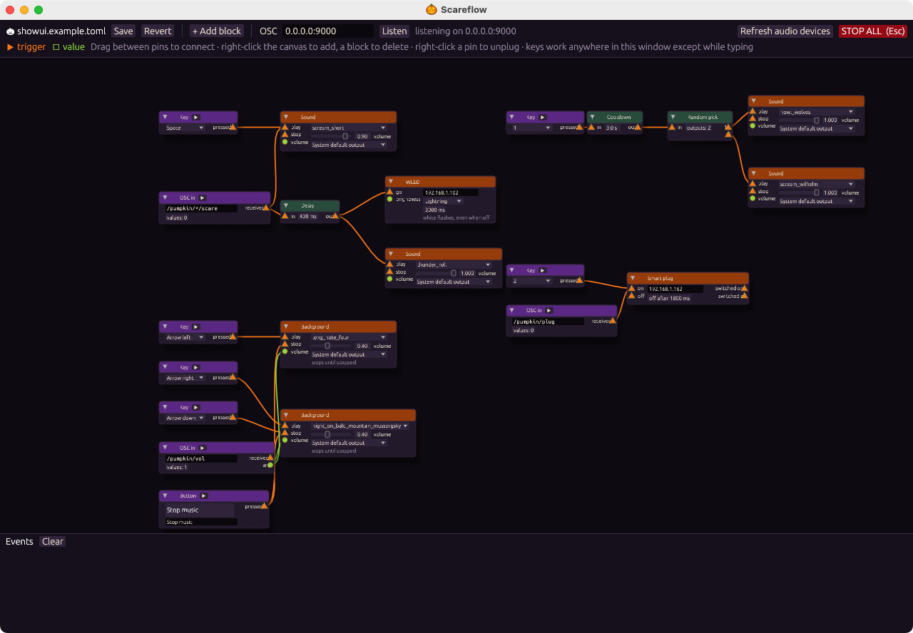

# Scareflow

A node-based show controller for haunted houses, Halloween porches and other small live shows. Wire **key presses** and **OSC messages** through **delay**, **random** and **cooldown** blocks to **sounds**, **WLED** light effects, **Tasmota** smart plugs and **OSC** output. Sounds start within a few milliseconds of the trigger, so a scream lands with the lightning flash.

Scareflow is a Rust workspace. It runs on macOS and Linux.



| Crate | Purpose |
| --- | --- |
| `scareflow-showui` | 🎃 The node editor and runtime. Start here. |
| `scareflow-osc` | OSC event module: a UDP listener, address-pattern routing and pluggable responders for WLED (`wled`), OSC to other devices (`osc_out`, with a lightning effect), Tasmota plugs and a channel for a host application. |
| `scareflow-sound` | Sound module: a looping background track with low-latency one-shot effects on top. Effects never stop the music, which can optionally be ducked while they play. |
| `scareflow-showd` | A headless daemon that connects both modules from a TOML file. |

## Requirements

- Rust (edition 2024, so Rust 1.85 or newer).
- On Linux: the ALSA development headers (`libasound2-dev` on Debian/Ubuntu) and `pkg-config`.
- Optional: a [WLED](https://kno.wled.ge) controller, a [Tasmota](https://tasmota.github.io) smart plug, or any device that accepts OSC.
- Optional: [`just`](https://github.com/casey/just) for the shortcuts in the `justfile`.

## Quick start

```sh
cp showui.example.toml showui.toml
cargo run --release -p scareflow-showui -- showui.toml   # or: just
```

The example show expects audio files in `scare/` and `bg-music/`. They are **not** in this repository. See [Audio](#audio) for where to get them, or point the blocks at your own files.

## Audio

Audio files are kept out of git (see `.gitignore`). Two folders hold the credits for the sounds the example show uses, with a source link and licence for every file:

- [`scare/CREDITS.md`](scare/CREDITS.md): short scare effects (thunder, screams, howls) from Wikimedia Commons, under CC0, public domain, CC BY 4.0 and CC BY-SA 4.0.
- [`bg-music/CREDITS.md`](bg-music/CREDITS.md): background music by Kevin MacLeod (incompetech.com, CC BY 4.0) and public-domain classical recordings from Wikimedia Commons.

Download the files into those folders under the listed names, or use your own. Supported formats: wav, mp3, ogg and flac. **When you play CC BY or CC BY-SA sounds in public, credit them as the CREDITS files describe.**

## Development

```sh
cargo test --workspace
cargo clippy --workspace --all-targets -- -D warnings
```

The headless daemon and a test sender:

```sh
cp show.example.toml show.toml   # add an audio/ directory next to it
cargo run -p scareflow-showd -- show.toml
```

Send test messages with the bundled sender. Arguments are sent as an int, a float or a string, whichever parses first:

```sh
cargo run -p scareflow-osc --example send -- /pumpkin/porch/scare
cargo run -p scareflow-osc --example send -- --to 127.0.0.1:9000 /pumpkin/lightning lights /light/1 3000
```

## Remote control

Every **Key** block reacts to a normal keyboard key, so any Bluetooth keyboard or presenter remote can trigger cues. [Pimpkin Remote](https://github.com/JorenSix/pimpkin-remote) turns a Flipper Zero into a matching BLE remote.

## Show editor (`scareflow-showui`)

```sh
cp showui.example.toml showui.toml
cargo run -p scareflow-showui -- showui.toml
```

A 🎃 node editor. **Event** blocks are wired through **flow** blocks to **response** blocks. Orange ▶ cables carry a trigger ("something happened"); slime-green ● cables carry a value, such as an OSC argument. Pins only connect to the same kind.

| Block | Inputs | Outputs |
| --- | --- | --- |
| Key (Space, Enter, arrows, 1–3) | — | ▶ pressed |
| OSC in (address pattern) | — | ▶ received, ● arg1–4 |
| Delay | ▶ in | ▶ out after N ms |
| Random pick | ▶ in | ▶ one connected output at random |
| Cooldown | ▶ in | ▶ out, then ignores triggers for N s |
| Background (continuous loop) | ▶ play, ▶ stop, ● volume | — |
| Sound (triggered one-shot) | ▶ play, ▶ stop, ● volume | — |
| WLED: lightning, effect, preset or power | ▶ go, ● brightness (0–1 or 0–255) | — |
| Smart plug (Tasmota): on, then off again after N ms (default 1800) | ▶ on, ▶ off | ▶ switched on, ▶ switched off |
| OSC out (`ip:port`, address, float args) | ▶ send, ● value (replaces arg1) | — |

- Sound blocks each pick an audio output device. Each device has one background loop. On Linux with PipeWire or PulseAudio running, the list shows the sound server's outputs; without a sound server it shows the ALSA devices.
- A value updates its setting at once for background volume and WLED brightness. Other settings use the value on the next trigger.
- Keys work anywhere in the window, except while you type in a text field.
- The ▶ in an event block's header fires it for testing. Blocks light up when they fire.
- **Esc** or **STOP ALL** cancels pending delays, stops all sounds and fades out the music. The plugs keep their state.
- Right-click the canvas to add a block. Right-click a block to duplicate or delete it, and right-click a pin to unplug it.
- **Save** writes `[[node]]` and `[[wire]]` entries to the TOML file.
- The icon is generated by `crates/showui/assets/make-icon.swift`.

## How it works

`OscListener` → `OscEvent` channel → `Router` thread. The router matches the address against each route pattern. OSC wildcards `*`, `?`, `[a-z]` and `{a,b}` are supported. The router then gives every action of a matching route to the responder registered for that action's kind. If one responder fails, the error is logged and the remaining actions still run. Responders do slow work on their own threads: WLED HTTP requests are queued, and each lightning storm gets its own thread. As a result, OSC handling never waits on the network.

Action fields can refer to OSC arguments with `$1`, `$2`, … anywhere in text (`"/light/$1"`) or as a number (`volume = "$2"`).

## Configuration (`show.toml`)

See [`show.example.toml`](show.example.toml). Sections:

- `[osc]`: `listen` address. Default: `0.0.0.0:9000`. Set `builtin_routes = false` to disable the routes below.
- `[sound]`: `dir`, the looping `background`, `background_volume`, `duck_to`, `max_voices`, `fade_ms` and `buffer_frames` (audio callback size, default 128; smaller starts sounds sooner but may crackle, 0 leaves it to the system). Sound paths may not leave `dir`. The daemon keeps running without sound if no audio device is available.
- `[wled.<name>]`: `host` of a WLED controller. Commands are sent to its JSON API at `POST /json/state`.
- `[osc_out.<name>]`: `addr` (`host:port`) of an OSC device, such as a light at `192.168.1.102:8000`.
- `[[route]]`: an `address` pattern and its `actions`.

Actions:

| `type` | `cmd` | Fields |
| --- | --- | --- |
| `sound` | `play` | `file`, `volume` (optional, defaults to 1.0) |
| `sound` | `background` | `file` (cross-fades to the new loop) |
| `sound` | `background_volume` | `volume` |
| `sound` | `stop_background`, `stop_effects` | none |
| `wled` | `preset` | `target`, `preset` |
| `wled` | `power` | `target`, `on` |
| `wled` | `brightness` | `target`, `bri` (0–255) |
| `wled` | `effect` | `target`, `fx`, optional `sx`, `ix` and `col = [r, g, b]` |
| `wled` | `raw` | `target`, `json` (sent unchanged) |
| `wled` | `lightning` | `target`, `duration_ms` (3000), `col` (RGBW, default `[255, 255, 255, 255]`) |
| `osc_out` | `send` | `target`, `address`, `args` (sent as floats) |
| `osc_out` | `lightning` | `target`, `address`, `on` (1.0), `off` (0.0), `duration_ms` (3000) |
| `custom` | none | `kind` (responder name), `data` (free JSON) |

WLED `lightning` works whatever the strip is doing, even when it is off. It first reads the state from the controller. It then flashes every segment at full brightness with a solid colour and no transition, using the same timing as the OSC lightning below. When the storm ends it restores the saved power, brightness and segments. Retriggering replaces the running storm but keeps the state saved before the first one.

`lightning` sends random bursts of 1–4 short flashes, 30–150 ms each, separated by 200–1500 ms of darkness. It always ends with `off`. Triggering it again on the same address replaces the running storm.

## Built-in addresses

| Address | Arguments |
| --- | --- |
| `/pumpkin/sound/play` | file, [volume] |
| `/pumpkin/sound/stop` | none |
| `/pumpkin/bg/play` | file |
| `/pumpkin/bg/volume` | volume |
| `/pumpkin/bg/stop` | none |
| `/pumpkin/wled/preset` | target, preset |
| `/pumpkin/lightning` | target, address, duration_ms |

## Writing a responder

```rust
struct Smoke;
impl scareflow_osc::Responder for Smoke {
    fn name(&self) -> &str { "smoke" }
    fn handle(&mut self, action: &Action, event: &OscEvent) -> Result<(), ResponderError> {
        // keep this fast: hand slow I/O to a worker thread
        Ok(())
    }
}
router.register("smoke", Smoke);   // routes then use { type = "custom", kind = "smoke", data = {...} }
```

## Running on a Linux box

`scripts/build-showui-linux.sh` cross-compiles `scareflow-showui` for x86_64 Linux in a Docker container. `just deploy-eris host=user@machine.local` then copies the binary, the audio and `packaging/linux/run.sh` to `~/scareflow` on that machine. Make a first show file there with `scripts/generate-osc-show.py . out/showui.toml`, which adds an OSC-in block for every audio file. To start the editor from the desktop, copy `packaging/linux/scareflow.desktop` to `~/.local/share/applications/`.

## Using the crates in another application

1. Add path or git dependencies on `scareflow-osc` and `scareflow-sound`.
2. At startup, build a `Router`, register a `ChannelResponder::new("app", tx)` and the sound/WLED/OSC responders, and start an `OscListener`.
3. Drain the `Receiver<(Action, OscEvent)>` with `try_iter()` from your main loop and apply the events to your own state. Keep the `SoundHandle` around to play sounds directly.

None of these steps blocks the caller: responders do their slow work on their own threads.

## Licence

The code is MIT licensed; see [LICENSE](LICENSE). Audio files are not part of the repository and keep their own licences, listed in the CREDITS files.
